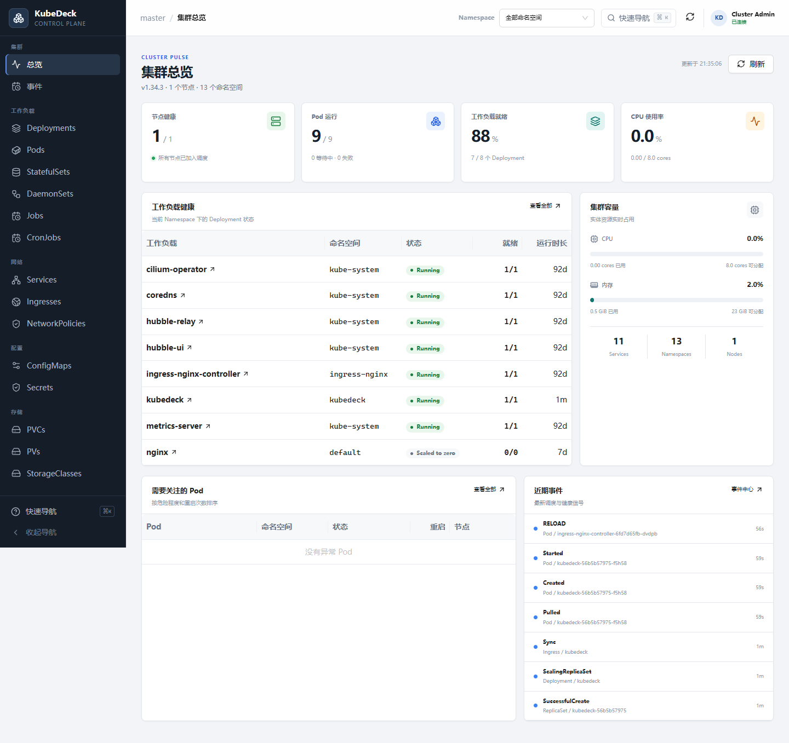
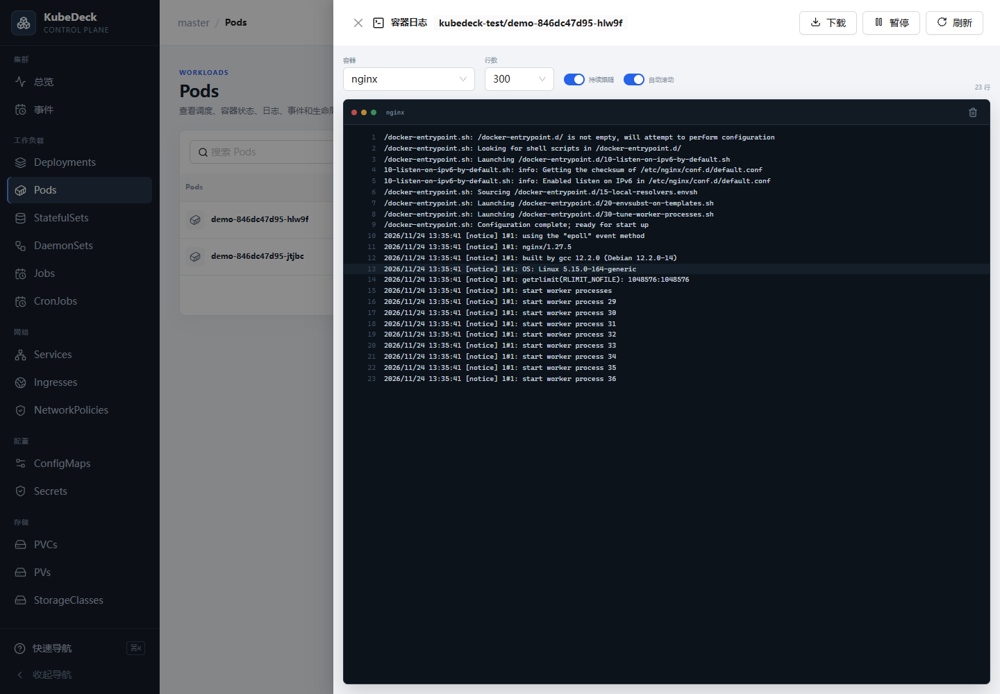
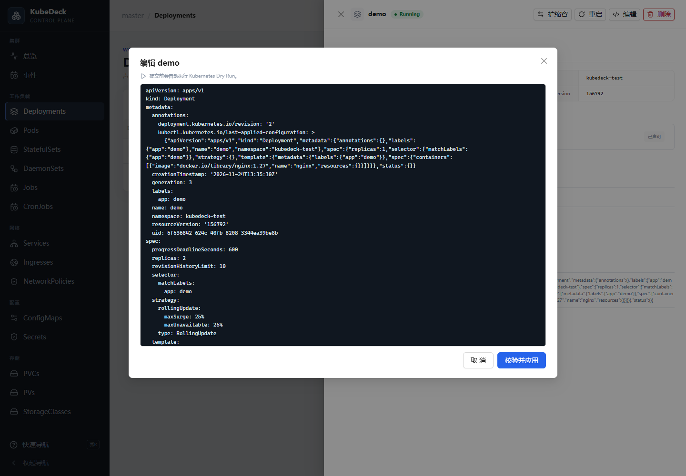
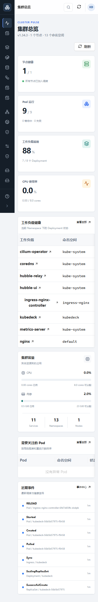

# KubeDeck

KubeDeck 是面向单集群日常运维的 Kubernetes 控制台。后端使用 Go 标准库直接访问 Kubernetes API，前端使用 React、TypeScript 和 Ant Design。



## 功能

- 集群总览：节点、Pod、Deployment、容量、Metrics Server、近期事件
- 资源列表：工作负载、网络、配置、存储、节点、命名空间
- 资源详情：元数据、容器、状态条件、标签、注解、YAML、关联事件
- 实时日志：容器选择、跟随、行数控制、自动滚动、下载
- 常用操作：扩缩容、滚动重启、删除二次确认
- YAML 编辑：自动执行 Kubernetes Dry Run 后提交
- 安全会话：HttpOnly Cookie、密码登录、限流、跨站写请求校验
- Secret 脱敏：详情和 YAML 中不返回 `data`、`stringData`
- 深浅色主题和响应式布局

## 页面预览

| 实时日志 | YAML 编辑 |
| --- | --- |
|  |  |

| 移动端 |
| --- |
|  |

## 本地构建

需要 Node.js 22+ 和 Go 1.24+。

```powershell
cd kubedeck
.\scripts\build.ps1
```

构建产物是 `work/kubedeck-linux-amd64`，前端已嵌入二进制。

## 部署

当前部署使用单节点 `hostPath`，把二进制放到节点 `/opt/kubedeck`：

```bash
mkdir -p /opt/kubedeck
# 将 kubedeck-linux-amd64 复制为 /opt/kubedeck/kubedeck
chmod 755 /opt/kubedeck/kubedeck
```

先创建命名空间和登录密钥：

```bash
kubectl create namespace kubedeck --dry-run=client -o yaml | kubectl apply -f -
kubectl -n kubedeck create secret generic kubedeck-auth \
  --from-literal=password='<password>' \
  --from-literal=session-secret='<random-secret>'
```

再部署应用：

```bash
kubectl apply -f deploy/kubedeck.yaml
```

访问：

- NodePort: `http://<node-ip>:30080`
- Ingress NodePort: `http://<node-ip>:31526`

## 权限边界

服务账号可以读取集群资源，并对常用 Namespaced 资源执行更新、补丁和删除。节点、命名空间、StorageClass 等集群级资源只读。更新 Secret 被明确禁止，避免脱敏视图覆盖真实数据。
